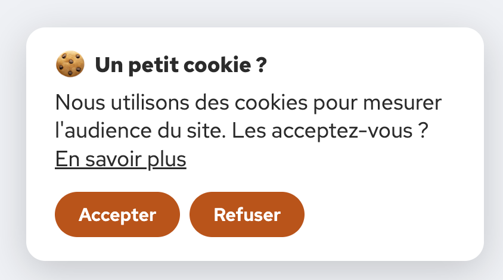

# Cookie Consent Lite

Accept / Decline banner for anonymous visitors of a Drupal site. Google
Analytics 4 loads only after "Accept"; "Decline" deletes the `_ga` cookies.
Any link with the `data-cookieconsent-open` attribute reopens the banner.



## Why this module

It replaces [drupal/cookieconsent](https://www.drupal.org/project/cookieconsent),
which cannot run on Drupal 11:

- the project is marked unsupported on drupal.org; its last release, 8.x-1.6,
  declares `core_version_requirement: ^8 || ^9`;
- its development branch stops at `^8 || ^9 || ^10` and has not moved since
  October 2023.

It was also only an information banner with a single "OK" button (cookie
`cookieconsent_dismissed`): it never blocked Google Analytics, which loaded
before any choice. This module asks Accept / Decline and loads GA4 only after
Accept.

Full consent managers (EU Cookie Compliance, Klaro!, COOKiES) handle many
trackers and cookie categories. This module stays small on purpose, for sites
whose only tracker is Google Analytics 4.

## Installation

```json
"repositories": [
    {"type": "vcs", "url": "https://github.com/SuperFredR/cookieconsent_lite"}
]
```

```sh
composer require superfredr/cookieconsent_lite
drush en cookieconsent_lite
```

Then set the measurement ID on the settings page.

## Configuration

Settings live at Configuration › System › Cookie Consent Lite
(`/admin/config/system/cookieconsent-lite`, permission "Administer the cookie
consent banner"). With the Configuration translation module, a "Translate" tab
lets each language have its own texts and "Read more" link.

A French translation ships in `translations/fr.po` and is imported by the
Interface translation module: on a French site the banner and its settings
page are in French from the start.

The banner shows only once the measurement ID is set. Safari caps cookies set
from JavaScript at 7 days, so its visitors see the banner again after a week
without a visit, whatever the configured lifetime. The "Read more" link
accepts an internal path (`/privacy`) or a full http(s) URL.

## Letting visitors change their mind

Add a link with the `data-cookieconsent-open` attribute anywhere on the site,
usually in the footer. Clicking it reopens the banner. In a Twig template:

```twig

  <a href="#" data-cookieconsent-open>{{ 'Cookie settings'|t }}</a>

```

Or in a custom block body, in source mode, as long as the text format keeps
the attribute (Full HTML does; Basic HTML needs it allowed):

```html
<a href="#" data-cookieconsent-open>Cookie settings</a>
```

The link only works where the banner is active: for anonymous visitors, once
the measurement ID is set. Hide it from logged-in users, as the Twig example
does.

## Theming

Colors come from CSS custom properties the theme can override:

```css
:root {
  --cookieconsent-bg: #fff;
  --cookieconsent-text: #2b2b2b;
  --cookieconsent-accent: #b8541a;
  --cookieconsent-accent-text: #fff;
}
```

The banner sits bottom right. To move it to the left:

```css
@media (min-width: 577px) {
  .cookieconsent-lite {
    right: auto;
    left: 1rem;
  }
}
```

## Content Security Policy

- `script-src`: `*.googletagmanager.com`, `*.google-analytics.com`
- `connect-src`: `*.googletagmanager.com`, `*.google-analytics.com`,
  `*.analytics.google.com`, `stats.g.doubleclick.net`
- `img-src`: `*.googletagmanager.com`, `*.google-analytics.com`
